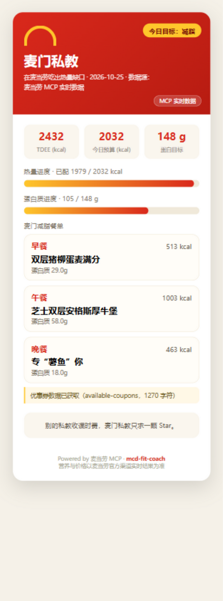

# 麦门私教 mcd-fit-coach 🍔🔥

> 在麦当劳吃出热量缺口 · Fit Coach powered by McDonald's MCP

**1024 程序员节 · 麦当劳程序员创意开发大赛** 参赛作品。

谁说减脂不能吃麦当劳？麦门私教通过麦当劳官方 MCP 获取真实菜单营养数据，
按你的身高、体重、活动水平算出 TDEE 与热量缺口，再用真实餐品拼出一份
「刚好落在预算里」的麦门减脂餐单，并生成一张可以直接发社交媒体的分享卡片。



## 30 秒上手（无需 Token，无需任何依赖）

```bash
python fit_coach.py --mock
```

Python 3.8+ 标准库即可运行，零第三方依赖。命令会生成
`maimen_fit_card.html` —— 浏览器打开，一张可截图的麦门减脂卡片就完成了。

## 接上真实的麦当劳 MCP（3 步）

1. 打开麦当劳 MCP 开放平台 [open.mcd.cn/mcp](https://open.mcd.cn/mcp)，
   点右上角**「登录」**（注意：不要点「立即体验」，那是商户平台入口），
   用**麦当劳 APP / 微信 / 支付宝扫码**即可登录——平台没有独立注册环节，扫码即开通；
2. 登录后右上角变成**「控制台」**，点开 → 点**「激活」** → 同意协议 → 复制 MCP Token；
3. 运行（Token 也可以用环境变量 `MCD_MCP_TOKEN`）：

```bash
python fit_coach.py --height 175 --weight 82 --age 30 --sex m --activity light --goal cut --token 你的Token
```

想知道麦当劳 MCP 服务端到底开放了哪些能力？直接打印工具清单：

```bash
python fit_coach.py --list-tools
```

## 它是怎么算的

| 环节 | 方法 |
|---|---|
| 基础代谢 BMR | Mifflin-St Jeor 公式（10×体重 + 6.25×身高 − 5×年龄 ± 性别修正） |
| 每日消耗 TDEE | BMR × 活动系数（久坐 1.2 / 轻度 1.375 / 中度 1.55 / 高强度 1.725） |
| 目标热量 | 减脂 −400 kcal，维持 ±0，增肌 +300 kcal，并设热量下限保护 |
| 蛋白质目标 | 减脂 1.8 g/kg，维持 1.4 g/kg，增肌 1.6 g/kg |
| 配餐算法 | 早 30% / 午 40% / 晚 30% 分配预算，按「热量贴近 + 高蛋白加权」贪心选择真实餐品，再用加餐把总热量补进预算 ±8% |

## 为什么值得一颗 Star

- ✅ **真实接入麦当劳 MCP**：Streamable HTTP + JSON-RPC 2.0 + Bearer Token，标准库手写客户端（`fit_coach.py` 内 `McpClient` 类，~60 行读懂 MCP 握手全过程）；
- ✅ **工具发现式调用**：不硬编码工具名，`--list-tools` 实时发现服务端能力，营养/优惠券工具按名称与描述模糊匹配，字段名容错提取（calorie/energy/热量 都认）；
- ✅ **诚实的演示模式**：`--mock` 生成的卡片自动盖上「演示数据 · MOCK」水印，真实模式标注「MCP 实时数据」，绝不冒充；
- ✅ **为传播而生的产出物**：单文件 HTML 卡片，无外部资源、390px 移动端宽度，截图即海报；
- ✅ **隐私安全**：Token 只从环境变量读取，仓库中不含任何真实凭证（配置文件仅占位符）。

## 项目结构

```
mcd-fit-coach/
├── fit_coach.py            # 全部逻辑：MCP 客户端 / 营养计算 / 配餐 / 卡片生成
├── demo/
│   ├── sample_card.html    # 示例卡片（由麦当劳 MCP 实时数据真实生成）
│   └── card-preview.png    # 卡片截图预览
├── MCP_INTEGRATION.md      # 麦当劳 MCP 接入说明（协议、工具清单、业务价值）
├── CONTEST_DECLARATION.md  # 参赛声明（官方模板）
└── mcp-config.example.json # MCP 连接配置示例（脱敏，与官方指南格式一致）
```

> 说明：本项目未使用 WorkBuddy 开发，按官方定义 `workbuddy.md` 为 WorkBuddy
> 对话上下文，故不提交该文件，亦不申请 WorkBuddy 联动积分奖励。

## 参赛信息

- 大赛仓库：https://github.com/M-China-Official/mcd-developer-innovation-challenge
- MCP 能力申请：https://open.mcd.cn
- 接入细节见 [MCP_INTEGRATION.md](MCP_INTEGRATION.md)

## 免责声明

项目输出仅供参考，不构成医疗、营养或任何专业建议；餐品信息、价格及
供应状态以麦当劳官方渠道的实时结果为准。请理性饮食，健康生活。

---

如果这张卡片帮你省去了「减脂能不能吃麦当劳」的纠结，给仓库点个 Star，
是麦门私教收到的全部课时费。🍔
